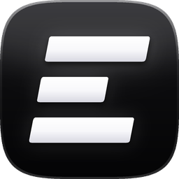
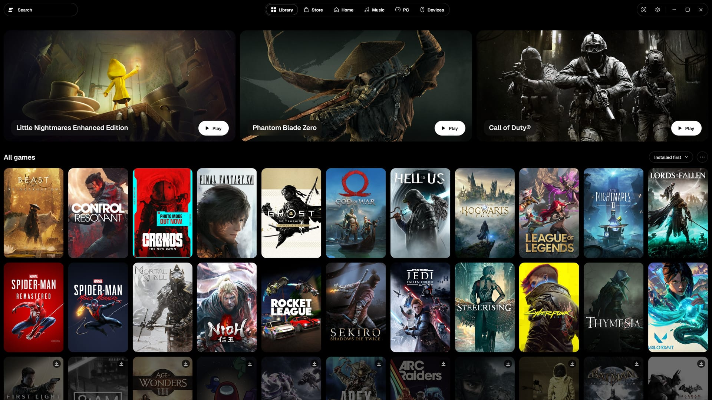

<h1 align="center">Exo Launcher 3.26</h1>

<strong>Every game store, Discord, your music, your captures and your mouse in one app for Windows 11.</strong>

  <a href="https://getexo.app/download/launcher"><strong>Download for Windows 11</strong></a>
  · <a href="https://getexo.app/launcher/changelog">What's new in 3.26</a>
  · <a href="CHANGELOG.md">Changelog</a>
  · <a href="PRIVACY.md">Privacy</a>
  · <a href="LICENSE">License</a>

## Release source

This snapshot comes from `release/3.26.0` at `7e1289f`. The recovered
`VERSION` said `3.25.0`; it was updated here to `3.26.0` to match the
changelog and published installer.

Exo Capture source is left out until its licensing is confirmed.
This snapshot also omits internal attack-reproduction harnesses.
First-party source is [MIT licensed](LICENSE); third-party components
keep their own licenses.

## Download

See [release information and installer checksums](../../RELEASES.md).
Exo Launcher requires Windows 11 x64.

**Open-source parts that ship with Exo** keep their own licenses, and their source is public:

- [Exo Mouse](https://getexo.app/source) (AGPL-3.0-or-later), built on OpenMouse by snekxs.
- OBS Studio's game capture hook (GPL-2.0-or-later), unchanged, which Exo Capture runs for a game in exclusive full screen. Exo Capture itself is Exo's own; [its versions up to 3.17.1](https://getexo.app/source) are GPL-3.0-or-later.
- [Exo Shaders](https://getexo.app/source) (GPL-3.0-or-later), based on SCSKiller.
- [Exo Shield](https://getexo.app/source) (GPL-3.0), Exo's blocker, made from uBlock Origin Lite and HaGeZi's Multi PRO list, and SponsorBlock (GPL-3.0), in the music players' browser.

Every bundled library and tool is listed in [Third-party notices](THIRD_PARTY_NOTICES.md).

**Not affiliated.** Exo Launcher is independent and not affiliated with or endorsed by Valve, Epic Games, GOG, Riot Games, Microsoft, EA, Ubisoft, Blizzard, Amazon, Discord, Spotify, Apple, Google, NVIDIA, AMD, Intel, OBS Studio or any other company it works with. Their names, logos and game art belong to their owners. Your use of each service stays under that service's own terms.

---

[Help](docs/HELP.md) · [Report an issue](https://getexo.app/help) · [Support development](https://www.buymeacoffee.com/UhhErix)

© 2026 Erix ([UhhErix](https://github.com/UhhErix)).
