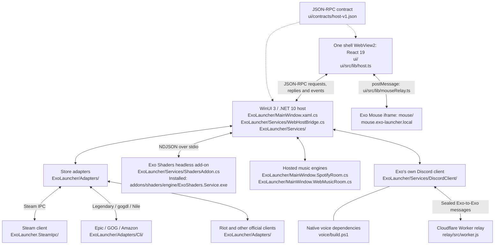

# Architecture overview

Exo is a Windows 11 launcher: one UI over official store clients, which stay installed
where the vendor put them and become invisible backends. Exo does not replace their
ownership checks or DRM. This page maps the shipping React/WebView2 runtime, not the
planned GPUI UI migration described in [AGENTS.md](../../AGENTS.md).

Paths below are relative to `apps/launcher/` unless marked as installed paths.
For the detailed runtime notes, read [Exo Launcher architecture](../../ARCHITECTURE.md).

## Runtime shape

The single WebView2 above is the **shell**, not a claim that the whole app has only
one browser view. Music engines are separate hosted service pages sharing the
WebView2 environment; store sign-in can use short-lived environments of its own.
The shell uses `app.exo-launcher.local`; embedded music uses the `embedded` profile.

Music draws Exo's own player (`ui/src/components/music/`, `ui/src/lib/musicAdapters.ts`)
over Spotify, YouTube Music or Apple Music's hidden web engine. Sign-in uses the
service's own page. Playback, tokens and entitlements stay in that page.
Discord is not a hosted Discord desktop app or web page: native services hold the
session, REST, gateway and voice; `ui/src/components/discord/` draws the client.

Exo Shaders is a separate process, not an in-process library. Its separate project
is omitted from this snapshot. The installed engine is reached through
`ExoLauncher/Services/ShadersAddon.cs`; the launcher draws its board in
`ui/src/components/shaders/ShadersBoard.tsx`. The engine is not started just by
opening the board.

Exo Capture's host integration exists (`ExoLauncher/Services/CaptureAddon.cs` and
`ExoLauncher/MainWindow.Capture.cs`): it talks to a separate installed add-on over
NDJSON/stdio for replay, recording and snips. The `capture/` source directory is
**not present in this checkout**, so it is not drawn as a source-tree component.

## Layers and components

| Component | Path | Role |
| --- | --- | --- |
| Native window | `ExoLauncher/MainWindow.xaml.cs`, `ExoLauncher/MainWindow.*.cs` | Owns the shell, hosted views and native lifecycle. |
| Native services and bridge | `ExoLauncher/Services/`, `ExoLauncher/Services/WebHostBridge*.cs` | Dispatches typed UI requests; owns discovery, installs, launch and native state. |
| Shell UI | `ui/src/components/LauncherApp.tsx`, `ui/src/components/shell/BootGate.tsx` | Places and warms rooms; React owns pixels. |
| Bridge client and contract | `ui/src/lib/host.ts`, `ui/contracts/host-v1.json` | Typed requests, results and events across the native boundary. |
| Store backends | `ExoLauncher/Adapters/`, `ExoLauncher.SteamIpc/` | Official-client integration and external CLI orchestration. |
| Music | `ui/src/components/music/`, `ExoLauncher/Helpers/SpotifyNative.cs`, `ExoLauncher/Helpers/YouTubeMusicNative.cs`, `ExoLauncher/Helpers/AppleMusicNative.cs` | Exo player over service-owned web engines. |
| Discord | `ui/src/components/discord/`, `ExoLauncher/Services/DiscordClient/` | Exo's own UI and native Discord client. |
| Mouse | `mouse/`, `ui/src/lib/mouseRelay.ts`, `ExoLauncher/Services/Hid/` | Separate device UI, bounded relay and native HID access. |
| Shaders | `ExoLauncher/Services/ShadersAddon.cs`, `ui/src/components/shaders/` | Launcher integration for the separate headless engine. |
| Capture integration | `ExoLauncher/Services/CaptureAddon.cs`, `ExoLauncher/MainWindow.Capture.cs` | Controls the separate installed capture program; source absent here. |
| Relay | `relay/src/worker.js`, `relay/README.md` | Worker/Durable Object topics forward opaque, end-to-end encrypted Exo messages for calls and friend links. |
| Voice dependencies | `voice/build.ps1`, `voice/apm/`, `voice/deepfilter/` | Builds native Discord voice dependencies, including DAVE, Opus and audio processing. |

Steam install, update and uninstall go through `ExoLauncher.SteamIpc`; Epic uses
Legendary, GOG uses gogdl, and Amazon uses Nile when present. Riot has its own wired
actions. Other adapters expose proven on-disk installs and hand work back to the
official client or Windows uninstaller rather than inventing ownership.
See [vendor backends](vendors.md) for the supported actions and exceptions.

## Trust boundaries

- **Native authority.** Secrets and filesystem paths stay native; React gets bounded
  DTOs. `ui/src/lib/host.ts` is the UI entry point, not direct filesystem access.
  The bridge contract is `ui/contracts/host-v1.json`.
- **Browser profiles.** The shell has web messages and no host objects. Embedded
  service views must not receive shell host objects or virtual hosts. Extensions
  belong only to the embedded profile, never the shell.
- **Anti-cheat.** `ExoLauncher/Services/AntiCheatCheck.cs` is the shared decision
  point; unreadable installs count as unknown, not safe. Its `Allows` policy gates
  changes by kind. Exo never changes Riot games or Vanguard's driver/service, and
  never kills anti-cheat. Process termination is guarded by `ProcessTermination`.
- **Network.** `ExoLauncher/NetworkDestinations.cs` maps native network hosts to
  `PRIVACY.md`. Hosted pages' requests are outside that native-host inventory;
  the file documents that scope explicitly.
- **Mouse licensing and origin.** `mouse/` is a separate AGPL-3.0-or-later program
  (`mouse/LICENSE`), framed on its own origin. `ui/src/lib/mouseRelay.ts` accepts
  only the frame and allow-listed messages: HID, bounded game/profile data,
  appearance and mouse-core actions. Do not move AGPL code into `ui/` or Exo code
  into `mouse/`; Exo Launcher is not under the AGPL.
- **Add-on processes.** Shader and capture work crosses process boundaries over
  stdio. Exo's core does not capture the screen; capture is the add-on's job.

## Where to read next

Start with [ARCHITECTURE.md](../../ARCHITECTURE.md) for detailed runtime behavior,
[AGENTS.md](../../AGENTS.md) for enforced boundaries and checks, and
[CONTEXT.md](../../CONTEXT.md) for domain terms. The pages below include research
and historical decisions as well as current implementation notes; their own
status and dates matter.

- [Auto tune](auto-tune.md): CPU/GPU tuning research and decisions.
- [Capture editor](capture-editor.md): editor implementation review and candidate approaches.
- [Chat rooms](chat-rooms.md): earlier Discord room design, with its replacement noted.
- [Cinema art cache](cinema-art-cache.md): decision on caching art and metadata.
- [Discord client](discord-client.md): native client, protocol and UI responsibilities.
- [Discord remade](discord-remade.md): the 3.26 Discord room redesign.
- [Discord video](discord-video.md): cameras, Go Live and screen sharing.
- [Display best settings](display-best-settings.md): display-setting evidence and research.
- [GPU profiles](gpu-profiles.md): NVIDIA global profile rules and implementation.
- [Keep](keep.md): recording, checking and restoring values Exo writes.
- [Launcher tuning](launcher-tuning.md): hidden store clients and download tuning.
- [Liquid Glass](liquid-glass.md): material decisions, rendering and legibility.
- [Lucid inside](lucid-inside.md): integration decision and permission boundary.
- [Music engines](music-engines.md): current provider engines and lifecycle.
- [Music native](music-native.md): native-engine research, evidence and plan.
- [NVIDIA Control Panel](nvidia-control-panel.md): setting getters, writers and research.
- [NVIDIA driver install](nvidia-driver-install.md): driver installation research and built flow.
- [Release 3.25.0](release-3.25.0.md): preparation and verification record.
- [Session recorder](session-recorder.md): local frame-time measurement.
- [Shader rebuild](shader-rebuild.md): driver-change rebuild watcher and code map.
- [Store quiet](store-quiet.md): notification suppression and restoration policy.
- [Store windows](store-windows.md): client identity and safe window hiding.
- [Update manual checks](update-manual-checks.md): installed-app update verification checklist.
- [Vendor backends](vendors.md): store commands, progress parsing and Steam helper internals.
- [Voice and links](voice-and-links.md): speech-enhancement research and local link checks.
- [Architecture decision records](../adr/): the separate ADR directory.
- [Owner decisions](../decisions/): dated rules, reasons and superseded decisions.
- [Repository overview](../../../../README.md): snapshot contents and omitted add-on source.
- [Rooms roadmap](../../../../ROADMAP.md): implemented surfaces, gaps and ownership.
