# Exo All-in-One Interactive First-Run Setup & Tour

**Scope:** Read-only audit of Exo's existing first-run onboarding and guided tour across React (`ui/` on `main`) and Native Rune (`native-ui/crates/exo-ui` on `feat/native-polish-2`), plus the design for **one unified, interactive first-run setup** that merges account/store setup, automatic device configuration (from `docs-audit/devices/plan.md`), optional PC tuning, and a hands-on coach-mark tour inside live rooms. **Zero source files were edited.**

---

## 1. Inventory: What Exists Today

### 1.1 React WebView2 UI (`apps/launcher/ui/` on `main`)

Today React forces a new user through **two separate, disconnected sequences** — a 9-step full-screen onboarding wizard (`OnboardingPanel.tsx`) followed 750 ms later by a 9-step modal slideshow tour (`ExoTour.tsx`) — up to **18 screens** before the user can simply play a game.

*(Note: `apps/launcher/ui/src/setup/main.tsx` is the pre-launch Windows installer/updater WebView2 dialog drawn by `setup/src/main.cpp`, not in-app onboarding.)*

#### A. First-Run Onboarding (`OnboardingPanel.tsx`, `BootGate.tsx`, `LauncherApp.tsx`)

* **Entry gate:** `LauncherApp.tsx:766-779` calls `bootGate(...)` (`BootGate.tsx:107`), which renders `OnboardingPanel` whenever `settings.onboardingComplete === false`. Completing calls `finishOnboarding` (`LauncherApp.tsx:567`), persisting `settings.set({ onboardingComplete: true })` and writing the marker file (`SettingsService.cs:271-307`).
* **No global "Skip setup" path:** Users must step through every visible screen until the final step.
* **No Devices setup step at all:** Controllers, Wooting keyboards, Exo Mouse, and Exo EQ are completely absent from onboarding.

| # | Step ID | Title | File:Line | What It Sets Up / Teaches | Host RPCs Called | Conditional / Skippable? |
|---|---|---|---|---|---|---|
| 0 | `welcome` | Welcome to Exo | `onboarding/model.ts:2`, `OnboardingPanel.tsx:384-391` | Logo + single `Get started` button; kicks off background scans (`backup.status`, `replaced.scan`, `deps.list`, `stores.check`/`matrix`, `gpu.profile`, `system.health`/`drives`/`tuning`, `settings.get`). | `backup.status`, `replaced.scan`, `deps.list`, `stores.check`, `stores.matrix`, `gpu.profile`, `system.health`, `system.drives`, `system.tuning`, `settings.get` | Always shown; no `Skip setup` CTA |
| 1 | `account` | Exo account | `onboarding/model.ts:3`, `onboarding/AccountStep.tsx:38-180` | Optional Exo account creation, sign-in, recovery code confirmation, or password reset. | `exoAccount.overview`, `exoAccount.create`, `exoAccount.signIn`, `exoAccount.signOut`, `exoAccount.newRecoveryCode`, `exoAccount.reset`, `exoAccount.markAsked` | Auto-skips if already signed in/asked (`OnboardingPanel.tsx:224-226`); has `Continue without account` |
| 2 | `restore` | Restore your data | `onboarding/model.ts:4`, `onboarding/RestoreStep.tsx:11-51` | Offers to restore settings, folders, collections, covers, playtime, and notes from a local Exo backup. | `backup.status`, `backup.restore`, `backup.decline` | Conditional (`restoreOffer !== null`, `OnboardingPanel.tsx:138`) |
| 3 | `clients` | Game clients | `onboarding/model.ts:5`, `clients/ClientsCard.tsx:73-201` | Checks third-party store clients / dependencies and offers automated repair/install. | `clients.status`, `clients.fix` | Conditional (`clientsOffered`, `OnboardingPanel.tsx:138`); deferrable via `Later` |
| 4 | `stores` | Your game stores | `onboarding/model.ts:6`, `onboarding/StoresStep.tsx:45-95` | Sign into/open detected stores (Steam, Epic, GOG, Riot, Xbox, EA), install missing game runtimes, add portable game folders. | `stores.check`, `stores.matrix`, `stores.auth`, `deps.list`, `runtimes.install`, `settings.set` (folders) | Always shown; can click `Continue` without connecting |
| 5 | `apps` | Music | `onboarding/model.ts:7`, `onboarding/AppsStep.tsx:15-66` | Radio-group choice of preferred music service (`spotify`, `apple`, `youtube`). | `web.preferences.get`, `web.preferences.set` | Always shown; full dedicated screen for 1 radio choice |
| 6 | `discord` | Discord | `onboarding/model.ts:8`, `onboarding/DiscordStep.tsx:9-32` | Checks if built-in Discord is signed in; blocks `Continue` while `junk.scan` runs (`model.ts:24-26`, `OnboardingPanel.tsx:408`). | `discord.status`, triggers `junk.scan` in background | Always shown; mostly a status card |
| 7 | `cleanup` | Clean up | `onboarding/model.ts:9`, `onboarding/CleanupStep.tsx:25-83` | Removes replaced apps/leftovers (e.g. legacy tools) and cleans detected junk files behind confirmation buttons. | `replaced.scan`, `replaced.remove`, `junk.scan`, `junk.clean` | Conditional (`cleanupHas`, `OnboardingPanel.tsx:61-63, 138`) |
| 8 | `pc` | Best settings for this PC | `onboarding/model.ts:10`, `onboarding/PcStep.tsx:7-29`, `gpu/BestSetup.tsx:26-99` | Applies Exo power plan, GPU driver profile, network tuning, HDR-for-games, Windows game defaults, frame-gen toggle, drive fixes, plus `Open Exo when Windows starts`. | `system.health`, `gpu.profile`, `system.tuning`, `system.drives`, `settings.set` | Always shown; `Optimize & open Exo` or `Skip for now` (`OnboardingPanel.tsx:455-457`) |

#### B. Guided Tour in React (`lib/tour.ts`, `ExoTour.tsx`, `useExoTour.ts`)

* **Trigger:** `useExoTour.ts:19-38` waits for `onboardingComplete === true`, `prefsLoaded`, and zero active modals, then auto-opens after `750 ms` if `uiPref('tourSeen') < 1` (`TOUR_VERSION = 1`, `lib/tour.ts:3, 116-119`).
* **Replay:** `Settings › About › Take the tour` (`AboutSection.tsx:117`) or `Ctrl+K` dispatches `exo-tour-start` (`lib/tour.ts:4, 112-114`).
* **Interaction flaw:** Renders a modal portal (`ExoTour.tsx:178-251`, `role="dialog" aria-modal="true"`) with a visual cutout spotlight around `.exo-nav-btn` / `.exo-bar-search` / `.exo-settings-btn`, but **blocks the real room** — users can only click `Next` / `Back` / `Skip` or press arrows/Esc (`ExoTour.tsx:140-172`). It teaches by telling, not by doing.

| # | Step ID | Room | Target Selector (`lib/tour.ts`) | Teaches |
|---|---|---|---|---|
| 1 | `welcome` | `library` | `null` (centered modal) | Overview of Exo (`lib/tour.ts:29-37`) |
| 2 | `library` | `library` | `.exo-nav-btn[aria-current="page"]` | Unified poster deck, keyboard/controller browse (`lib/tour.ts:39-46`) |
| 3 | `search` | `library` | `.exo-bar-search` | `Ctrl+K` command search (`lib/tour.ts:48-55`) |
| 4 | `store` | `store` | `.exo-nav-btn[aria-current="page"]` | Store shelves, wishlist, gifts (`lib/tour.ts:57-64`) |
| 5 | `discord` | `friends` | `.exo-nav-btn[aria-current="page"]` | Built-in Discord, calls, top-bar island (`lib/tour.ts:66-73`) |
| 6 | `music` | `music` | `.exo-nav-btn[aria-current="page"]` | Music player & `F` Immersive mode (`lib/tour.ts:75-82`) |
| 7 | `devices` | `devices` | `.exo-nav-btn[aria-current="page"]` | Exo Mouse, Wooting, EQ, Controller Lab (`lib/tour.ts:84-91`) |
| 8 | `exoai` | `exo-ai` | `.exo-nav-btn[aria-current="page"]` | Exo AI Auto Tune, drivers, shaders, Apps (`lib/tour.ts:93-100`) |
| 9 | `settings` | `library` | `.exo-settings-btn` | Stores, Riot sync, Liquid Glass, replay tour (`lib/tour.ts:102-109`) |

---

### 1.2 Native Rune UI (`apps/launcher/native-ui/crates/exo-ui/` on `feat/native-polish-2`)

* **First-run onboarding:** **Does not exist.** Neither `shell.rs` nor `state.rs` reads `onboardingComplete`; native boots straight into Library regardless of first-run state.
* **Guided Tour (`tour.rs`, `state.rs`, `shell.rs`, `palette.rs`, `settings.rs`, `main.rs`):**
  * **Trigger:** `state.rs:856-868` (`apply_settings`) checks `settings.ui_prefs["tourSeen"] >= 1`; if unseen and connected, calls `self.start_tour()` (`state.rs:1643-1649`).
  * **Presentation:** `shell.rs:47, 579-580` marks `modal_open = true` and mounts `tour::layers(s, budget.overlay)` — a full-screen 50% black scrim (`tour.rs:177-182`) with a 460 px Liquid Glass card pinned at bottom-center (`tour.rs:170-191`). **Zero spotlighting, zero coach-marks, zero room interaction.**
  * **Controls & persistence:** Keyboard `Esc`/`Right`/`Left` (`main.rs:102-117`), `Back`/`Next`/`Done`/`Skip` buttons and dot pills (`tour.rs:66-168`). `finish_tour()` (`state.rs:1661-1672`) writes `settings.set({ uiPrefs: { tourSeen: 1 } })`.
  * **Replay entry points:** `Settings › Guided tour › Replay tour` (`settings.rs:320-329`), `Ctrl+K` palette item `"Take the guided tour"` (`palette.rs:20`, `state.rs:2173-2175, 2210`), Library overflow menu (`library.rs:333-337`).

| # | Title (`tour.rs:15-56`) | Room Switched To | File:Line | Teaches |
|---|---|---|---|---|
| 1 | Welcome to Exo | `Room::Library` | `tour.rs:16-20` | Native DX12 120 Hz intro, skip/replay |
| 2 | Your unified Library | `Room::Library` | `tour.rs:21-25` | Multi-store poster deck & one-click Play |
| 3 | Instant Ctrl+K Search | `Room::Library` | `tour.rs:26-30` | Launch games, switch rooms, activate key |
| 4 | Store & Price Compare | `Room::Store` | `tour.rs:31-35` | Featured picks, price comparison, historical lows |
| 5 | Built-in Discord | `Room::Discord` | `tour.rs:36-40` | Friends, voice calls, hardware-decoded streams |
| 6 | Music without clutter | `Room::Music` | `tour.rs:41-45` | Apple Music, Spotify, YouTube Music |
| 7 | Exo AI, Devices & Apps | `Room::ExoAi` | `tour.rs:46-50` | Auto tuning, shaders, startup apps, peripherals |
| 8 | You're ready to play | `Room::Settings` | `tour.rs:51-55` | Riot sync, motion, updates, replay tour |

---

## 2. Unified All-in-One Interactive Setup Design

### 2.1 Design Principles
1. **One continuous flow, zero duplicate welcomes:** Replaces both the 9-step React onboarding wizard and the 8/9-step slideshow tour with **5 tight stages** (~60–90 s typical, ~3–5 s skip).
2. **Real setup first, real actions second:** First configure the user's real stores, apps, and connected hardware (reusing our automated Devices flow from `docs-audit/devices/plan.md`), then let them learn Exo by doing **3 real actions in real, unblocked rooms**.
3. **Zero silent mutations, explicit consent:** Read-only discovery runs in the background from second zero (`stores.check`, `devices.list`, `backup.status`, `eq state`). Nothing is downloaded, installed, deleted, or written to Windows/hardware until the user confirms.
4. **Every step skippable, always resumable:** Every screen has `Skip step`; Welcome has `Skip setup`; any skipped item stays queued quietly under `Settings › Setup` (and `Ctrl+K › Resume setup`).
5. **Skip setup still lands somewhere great:** Skipping immediately lands in **Library** populated with locally discovered games (Steam/Epic/GOG/Riot/Xbox local manifests already read without sign-in) and a dismissible, non-blocking pill in `Settings › Setup` to finish Devices or Connections whenever ready.

### 2.2 Flow Map & Time Budgets

```mermaid
flowchart LR
  S0["0. Welcome\n(~5 s)"] -->|Start setup| S1["1. Accounts, Stores & Apps\n(~15-30 s)\nBackup offer · Exo acct · Stores · Music · Discord"]
  S0 -->|Skip setup ~3 s| LIB["Library (populated)\nResume anytime in Settings"]
  S1 -->|Continue / Skip| S2["2. Devices Hand-off\n(~25-45 s)\nEdge · Wooting 60HE v2 · Starlight X · Audio & EQ v2"]
  S2 -->|Continue / Skip| S3["3. Optional PC Defaults\n(~10 s, opt-in)\nPower/GPU/Network · Startup · Cleanup"]
  S3 -->|Continue / Skip| T1["4a. Live Room: Ctrl+K\n(Library, unblocked)\nPress Ctrl+K or click Search"]
  T1 -->|User does action / Skip| T2["4b. Live Room: Game Card\n(Library, unblocked)\nOpen a real game page"]
  T2 -->|User does action / Skip| T3["4c. Live Room: Devices\n(Devices Overview, unblocked)\nClick Change on a device"]
  T3 -->|User does action / Skip| S5["5. Done\n(~5 s)\nSummary + Open Library"]
  S5 --> LIB
```

| Path | Steps Completed | Estimated Duration | Landing State |
|---|---|---|---|
| **Fastest path (`Skip setup`)** | Welcome -> `Skip setup` | **3–5 seconds** | Live **Library** with auto-discovered local installs; `setup.status = "skipped"`; resumable in `Settings › Setup`. |
| **Quick path (pre-connected stores & calibrated gear)** | Welcome -> Confirm Connections -> Auto-verify 4 Devices -> Skip/apply PC defaults -> 3 interactive beats -> Done | **60–90 seconds** | Fully configured **Library** + simple **Devices overview** + Exo EQ v2 active. |
| **Full path (fresh PC: sign into 2 stores, Wooting backup, Edge calibration, APO consent install, PC defaults, interactive tour)** | All 5 stages including consent prompts | **2.5–3.5 minutes** | Complete setup; zero further setup prompts unless a new peripheral is plugged in. |

---

### 2.3 Detailed Step-by-Step Specification (Reads, Writes, Consent & Completion)

| Stage | Screen / Beat | Mockup (v2 full-window) | Reads on Entry (Host RPCs, read-only) | Writes Only on User Action / Consent | Skippable / Completion Trigger |
|---|---|---|---|---|---|
| **0** | **Welcome** | `mockups-v2/01-welcome.html` | Kicks off parallel background probes: `backup.status`, `exoAccount.overview`, `stores.check`, `stores.matrix`, `devices.list`, `deps.list`, `clients.status`, `web.preferences.get`, `discord.status`, `eq { action: "state" }`. Renders live discovery counts (big 2x2 stat block) over a full-bleed wall of real covers, with the found-on-this-PC panel. | **None.** | `Start setup` advances to Stage 1; `Skip setup` writes `setup.save({ status: "skipped" })` + `settings.set({ onboardingComplete: true, uiPrefs: { tourSeen: 1 } })` and opens Library. |
| **1** | **Accounts, Stores & Apps** *(merges old `restore`, `account`, `clients`, `stores`, `apps`, `discord`)* | `mockups-v2/02-accounts-library.html` | Displays already-loaded results across the full window: real-logo store rail/strip (`Steam`, `Riot`, `Epic`, `Roblox`, `GOG`, `Xbox`, `EA`, `Ubisoft`, `Battle.net`) streaming detected games into a large live cover wall, visual brand tiles for Music (`Spotify` / `Apple Music` / `YouTube Music`) and `Discord`, plus quiet inline Exo Account, local backup restore (only if `backup.status.offer != null`), and optional missing runtimes badge. | - Restore backup: `backup.restore` (explicit click) - Exo account: `exoAccount.create` / `signIn` / `markAsked` - Store auth: `stores.auth` -> `stores.matrix` -> `library.refresh` - Add folder: native folder picker -> `settings.set` - Missing runtimes / clients: `runtimes.install` / `clients.fix` (**explicit consent**) - Music choice: `web.preferences.set` | `Skip step` marks `connections: "skipped"` and advances; `Continue` saves `connections: "done"` (also calls `exoAccount.markAsked` if left local). |
| **2** | **Devices Auto-Setup Hand-off** *(embeds `docs-audit/devices/plan.md` §3)* | `mockups-v2/03-devices-handoff.html` -> reuses `docs-audit/devices/mockups-v2/02..04` | `devices.list`, `controller.read`, `keyboard.read`, `keyboard.backups`, `audio.read`, `eq { action: "state" }`, `system.mouseCore`. Presents 4 full-height panoramic hardware bays with real device photography (`DualSense Edge`, `Wooting 60HE v2` split bar, `Finalmouse Starlight X`, `ZiiGaat Lush` + `fifine Microphone`) and live pre-scan badges. | Steps cleanly through full-window per-device stages (same layouts in `docs-audit/devices/plan.md`): - **DualSense Edge:** verifies fw `2.17` & calibration over large controller hero with live stick/trigger callouts; runs `controller.calibrate` only if uncalibrated or requested; applies clean defaults (`controller.settings`). - **Wooting 60HE v2:** full-width `ANSI · Split spacebar` matrix (~1840 px at 1920x1080, with the automatic-backup and USB-port notes in the bottom dock); auto-creates local `keyboard.backup` before writing `keyboard.settings` (or keeps Wootility profile on choice). - **Starlight X:** reads wireless battery/DPI/Hz via AGPL Exo Mouse IPC; writes profile only on approval. - **Audio & Exo EQ v2:** full-width 20 Hz–20 kHz curve + 3-column bottom band; consent gate before `eq { action: "install" }` (APO) if missing; confirms headphone AutoEq (`eq { action: "headphone" }`), per-game auto-switching, Gunshot Guard, and confirms `fifine Microphone` stays on Exo Voice. | `Start automatic device setup` runs per-device stages (each individually skippable) and writes `devices.setupComplete`; `Skip devices for now` marks `devices: "skipped"` and advances. Auto-skips if zero configurable peripherals detected. |
| **3** | **Optional PC Defaults & Cleanup** *(merges old `pc` + conditional `cleanup`)* | `mockups-v2/04-pc-defaults.html` | `gpu.profile`, `system.health`, `system.drives`, `system.tuning`, `replaced.scan`, `junk.scan` (run lazily only on Stage 2->3 transition, never blocking Discord). Full-window PC hardware overview (RTX 3070, Ryzen 5 5600X, NVMe drive bar, Network) on the left ~62% with a floating Liquid Glass opt-in checklist panel on the right ~38%. | **Nothing applied automatically.** Toggles let user review exact actions (Power plan, GPU profile, Network tuning, HDR for games, Windows game defaults, Start with Windows, plus conditional Cleanup items). Clicking `Apply selected` runs only checked RPCs (`system.health('apply')`, `gpu.profile('apply')`, `system.tuning('apply')`, `system.drives('all')`, `replaced.remove`, `junk.clean`, `settings.set`). | `Skip for now` marks `pcTuning: "skipped"`; `Apply selected` marks `pcTuning: "done"`. |
| **4a** | **Interactive Tour — Beat 1: Instant Search (`Ctrl+K`)** | `mockups-v2/05-interactive-tour-room.html` | Switches to real **Library** room (unblocked, no modal scrim, full-bleed hero + installed cover shelf). Anchors a generously scaled, non-blocking Liquid Glass coach-mark below `.exo-bar-search` (or native `bar-search` key). | None (purely interactive UI training). | **Auto-completes** the moment the user presses `Ctrl+K` or clicks Search and opens the command palette (green checkmark draws inside the coach-mark, holds 450 ms, then transitions to Beat 2). Has `Skip step` & `Skip tour`. |
| **4b** | **Interactive Tour — Beat 2: Open a Real Game** | *(Real Library room, coach-mark on first poster)* | Highlights the first real poster card in the user's imported Library (`library.get`). *(If library is empty, adapts seamlessly to highlight `Store` tab or `Add a game folder` instead of pointing at nothing.)* | None. | **Auto-completes** when the user clicks/opens that game's page (showing playtime, launch options, and one-click Play). Has `Skip step` & `Skip tour`. |
| **4c** | **Interactive Tour — Beat 3: Live Devices Overview** | *(Real Devices full-width overview, coach-mark on `Change`)* | Switches to the finished full-width **Devices** overview (from `docs-audit/devices/plan.md`). Anchors coach-mark to the `Change` button of a real configured device (e.g. Wooting 60HE v2 or ZiiGaat Lush EQ). *(If no devices were set up, points to `Settings` instead.)* | None. | **Auto-completes** when the user clicks `Change` (or clicks `Done` in the coach-mark). Saves `tourBeatsCompleted` + `uiPrefs.tourSeen = 2`. |
| **5** | **Done** | `mockups-v2/06-done.html` | Full-window summary combining a real cover-wall backdrop, display headline, summary glass card, and a 4-column configured hardware row with real device photos. | Commits `setup.save({ status: "completed" })`, `settings.set({ onboardingComplete: true, uiPrefs: { tourSeen: 2 } })`. | Single white primary pill `Open Library` (plus subtle `Open Devices` secondary link). |

---

### 2.4 Persistence, Resume & Settings Integration

To make every step truly resumable from Settings without polluting synced cross-PC preferences with local hardware IDs:

1. **Local PC Setup State (`%LOCALAPPDATA%\ExoLauncher\setup-state.json`)** exposed via two new `host-v1.json` RPCs:
   * `setup.get` -> `{ version: 2, status: "not_started" | "in_progress" | "skipped" | "completed", lastStep: StepId, steps: Record<StepId, "pending" | "done" | "skipped">, tourBeats: Record<"search" | "game" | "devices", "pending" | "done" | "skipped">, devicesConfigured: string[], updatedAt: string }`
   * `setup.save` -> patches `setup-state.json` atomically after each stage/beat (and reconciles `settings.onboardingComplete` + `OnboardedMarkerPath` when `status` becomes `"completed"` or `"skipped"`).
2. **Existing synced pref compatibility (`uiPrefs.tourSeen`):**
   * Bump `TOUR_VERSION` from `1` to `2` (`tourSeen: 2` indicates the unified interactive setup/tour was completed or skipped; existing users who already finished v1 onboarding + v1 tour will NOT be forced back into full setup—only newly installed PCs or users who open `Settings › Setup` enter the flow, while existing users on native with unconfigured devices see only the non-intrusive Devices setup prompt inside the Devices room).
3. **Resuming later from Settings (`Settings › Setup` & `Ctrl+K`):**
   * Replaces the single `"Replay tour"` row (`settings.rs:320-329`, `AboutSection.tsx:117`) with a compact **Setup & tour** card showing live status pills for each stage (`Connections`, `Devices`, `PC defaults`, `Interactive tour`) and three clear actions:
     * `Resume setup` (shown when any stage is `pending` or `skipped` — jumps directly to the first unfinished stage).
     * `Replay interactive tour` (re-runs only Stage 4a–4c over live rooms without re-running account/device wizards).
     * `Run full setup again` (non-destructive reset of `setup-state.json` steps to `pending`, keeping existing backups, accounts, and calibrations intact).
   * `Ctrl+K` command palette registers `"Resume setup"` (when incomplete) and `"Replay interactive tour"`.

---

### 2.5 Exact Rune Motion Choreography (`exo-kit/src/tokens.rs` + `rune`)

All springs use the exact critically damped tokens in `apps/launcher/native-ui/crates/exo-kit/src/tokens.rs:157-161` (`bounce = 0.0`, zero overshoot):
* `SPRING_PRESS` (`0.09s`), `SPRING_QUICK` (`0.12s`), `SPRING_BASE` (`0.16s`), `SPRING_MOVE` (`0.22s`), `SPRING_FLIGHT` (`0.30s`).
* Programmatic/RPC-triggered step advances and coach-mark auto-completions **must** commit via `Tx::animated()`.

| Beat | Cast (`choreograph`) | Exact Rune API & Springs | Restraint & Hit-Testing | Reduce Motion (`cx.reduced_motion(true)`) |
|---|---|---|---|---|
| **Stage 0 -> 1 -> 2 -> 3 full-canvas advance** | **Lead:** full-window stage canvas (`Welcome` mosaic -> `Accounts` live wall -> `Devices` panoramic bays -> `PC defaults` split); **Support:** persistent full-width top stage track (no left rail anywhere in setup); **Static:** Void `#000` shell & footer actions | Incoming canvas: `Transition::asymmetric(Transition::offset(28.0, 0.0).combined(Transition::opacity()), Transition::offset(-28.0, 0.0).combined(Transition::opacity())).springs(SpringPair::new(SPRING_MOVE, SPRING_QUICK))`. Active stage indicator uses `.matched("setup-stage-track").motion(SPRING_BASE)`. | Only fires on explicit step advance; never loops. | `Transition::opacity().springs(SpringPair::new(SPRING_QUICK, SPRING_QUICK))` — zero horizontal travel. |
| **Stage 2 -> Full-window per-device stages** | **Lead:** hero device canvas (`DualSense Edge`, `Wooting 60HE v2`, `Starlight X`, `Audio & EQ v2`); **Support:** visual device-photo stepper checkmarks | Reuses exact choreography from `docs-audit/devices/plan.md` §3.3 (`SPRING_MOVE` / `SPRING_QUICK` + `.enter_delay(0.04 * idx)` on check rows + `Transition::draw()` on completed check). | Stops immediately on completion. | Pure opacity crossfade; zero stagger or path draw. |
| **Stage 3 -> Stage 4a (PC stage dissolves into live room)** | **Lead:** real Library room becoming crisp at full opacity; **Support:** anchored Liquid Glass coach-mark card entering beneath `.exo-bar-search` | PC stage exits via `Transition::scale(0.97).combined(Transition::opacity())` on `SPRING_QUICK`; coach-mark enters via `Transition::offset(0.0, 8.0).combined(Transition::opacity())` on `SPRING_MOVE` with `.enter_delay(0.08)`. **Crucial:** NO modal scrim (`tour-scrim` deleted); overlay layer is pointer-transparent everywhere outside the coach-mark popover so every real room control stays live and clickable. | One clean transition into live workspace. | Instant room reveal + `Transition::opacity()` on coach-mark (`SPRING_QUICK`). |
| **Interactive Beat completion (4a -> 4b -> 4c)** | **Lead:** coach-mark status badge turning `#3dd68c` with Lucide check; **Support:** target focus ring gliding to next real control | Checkmark uses `Transition::draw()` on `SPRING_BASE`, holds `450 ms` so the user sees their real action succeeded, then coach-mark moves to the next target anchor via `.matched("tour-coach-card").motion(SPRING_FLIGHT)` and focus ring via `.matched("tour-target-ring").motion(SPRING_MOVE)`. | Celebratory single beat per action; immediately interruptible by `Skip`. | Opacity swap (`SPRING_QUICK`), no ring flight, instant badge color change. |
| **Stage 4c -> Stage 5 (Done) -> Library** | **Lead:** full-window Done hero + hardware strip; **Support:** summary cells | Done canvas enters with `Transition::scale(0.97).combined(Transition::opacity())` on `SPRING_MOVE`; device strip cells settle with `.enter_delay(0.04 * idx)`. Clicking `Open Library` dissolves stage (`SPRING_QUICK`) onto already-rendered live Library. | Once at completion. | Pure `Transition::opacity()` on `SPRING_QUICK`. |

**Automated motion verification:** Add `apps/launcher/native-ui/crates/exo-ui/tests/setup_tour_motion_gate.rs` using `rune::motion_gate::Run` under both `reduce_motion = false` and `reduce_motion = true` (matching `discord.rs:3716-3746`), plus an interaction test proving clicking the real `bar-search` target while Beat 4a is active triggers the real palette and completes Beat 4a without being intercepted by any scrim.

---

### 2.6 What to Delete / Retire from Old Onboarding & Tour

Once the unified flow ships in native (and if React is kept in parity or retired on native switchover), remove these redundant pieces cleanly:

| Surface | Files / Symbols to Delete or Replace | Why |
|---|---|---|
| **Native Rune (`native-ui/crates/exo-ui/src/`)** | Delete old slideshow `tour.rs:15-56` (`STEPS` 8-slide static text), `tour.rs:177-182` (`tour-scrim` blocking scrim), and `shell.rs:47` (`s.tour_step.is_some()` blocking `modal_open`). Replace `state.rs:302-303, 1643-1672` (`tour_step`, `tour_seen`, `start_tour`, `jump_tour`, `finish_tour`) with unified `setup.rs` (`SetupState` + non-blocking interactive `CoachMark` overlay). Update `settings.rs:320-329` (`Replay tour` -> `Setup & tour` card) and `palette.rs:20` / `state.rs:2173-2175` (`StartTour` -> `ResumeSetup` / `ReplayTour`). | Eliminates the blocking 8-slide slideshow and adds real first-run setup + interactive room coach-marks to native. |
| **React WebView2 (`apps/launcher/ui/src/`)** | Retire `components/shell/ExoTour.tsx`, `components/shell/useExoTour.ts`, `lib/tour.ts` (`TOUR_STEPS` 9-slide modal), and `styles/tour.css`. Consolidate `components/OnboardingPanel.tsx` and the 4 standalone single-purpose step files (`onboarding/AppsStep.tsx`, `onboarding/DiscordStep.tsx`, `onboarding/RestoreStep.tsx`, `onboarding/CleanupStep.tsx`) into the unified 5-stage setup + interactive coach-mark runner (keeping reusable sub-widgets like `RecoveryCodeScreen.tsx` and `BestSetup.tsx` for Settings). Remove `AboutSection.tsx:117` lone `"Take the tour"` link in favor of the unified `Settings › Setup` section. | Eliminates the 18-screen double-onboarding/slideshow fatigue and aligns React and Native on one state model (`setup-state.json`). |
| **Host (`ExoLauncher/Services/`)** | Keep `SettingsService.cs:271-307` (`OnboardingComplete` + `OnboardedMarkerPath`) as the backward-compatible completion flag; add `SetupStateService.cs` (`setup.get` / `setup.save`) so resumable per-step progress and `devices-setup.json` share one coherent source of truth. | Zero breaking migration for existing installs; clean resume support across restarts. |

---

## 3. Static HTML Mockups (v2 Full-Window — 1920x1080, 2560x1440, 1280x720)

Full-window v2 mockups live in `docs-audit/onboarding/mockups-v2/` (with PNG screenshots at `1920x1080`, `2560x1440`, and `1280x720` in `docs-audit/onboarding/mockups-v2/screenshots/`, sharing real local game covers, hero art, hardware cutouts, store logos, and `Goeist` `.woff2` fonts from `docs-audit/assets/`). Original v1 centered-card mockups remain in `docs-audit/onboarding/mockups/` for comparison; see `docs-audit/setup-redesign.md` for full A/B rationale.

1. `01-welcome.html` — Full-bleed mosaic of 24 real covers under a gradient, persistent full-width top stage track (with live sub-lines and Done/Current states), huge `Welcome to Exo` type, a big 2x2 discovery stat block (`16 installed`, `4 devices`, `RTX 3070`, `~90 seconds`), and a floating Liquid Glass `Found on this PC` panel.
2. `02-accounts-library.html` — Top stage track; left real-logo store rail (`Steam`, `Riot`, `Epic`, `Roblox` connected, `GOG`, `Xbox`, `EA`, `Ubisoft`, `Battle.net` to connect); big live streaming cover wall; brand tiles for Music (`Spotify`, `Apple Music`, `YouTube Music`) and `Discord`; quiet right block with `Restore local backup`, `Exo account` and `Game clients`; header buttons `Add portable folder` and `Runtimes`.
3. `03-devices-handoff.html` — Four full-height panoramic hardware bays with real cutout photography for `DualSense Edge`, `Wooting 60HE v2` (`ANSI · Split spacebar`), `Finalmouse Starlight X`, and `ZiiGaat Lush` + `fifine Microphone`, handing directly into `docs-audit/devices/mockups-v2/`.
4. `04-pc-defaults.html` — Top stage track; full-window PC hardware overview (`RTX 3070`, `Ryzen 5 5600X`, `Local Disk C:`, `Network & Windows`) with a glass opt-in checklist panel on the right (nothing applied until confirmed).
5. `05-interactive-tour-room.html` — Live, unblocked **Library** room (full-bleed Call of Duty hero + 16 real installed covers) with a generously scaled non-blocking Liquid Glass coach-mark pointing at `Ctrl+K` Search and live interactive palette completion.
6. `06-done.html` — Full-window completion summary pairing a real cover-wall hero + `Open Library` CTA above a 4-column configured hardware strip and quiet `Settings › Setup` resume link.
