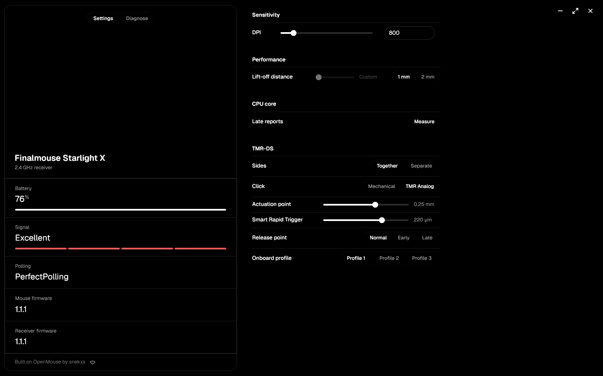
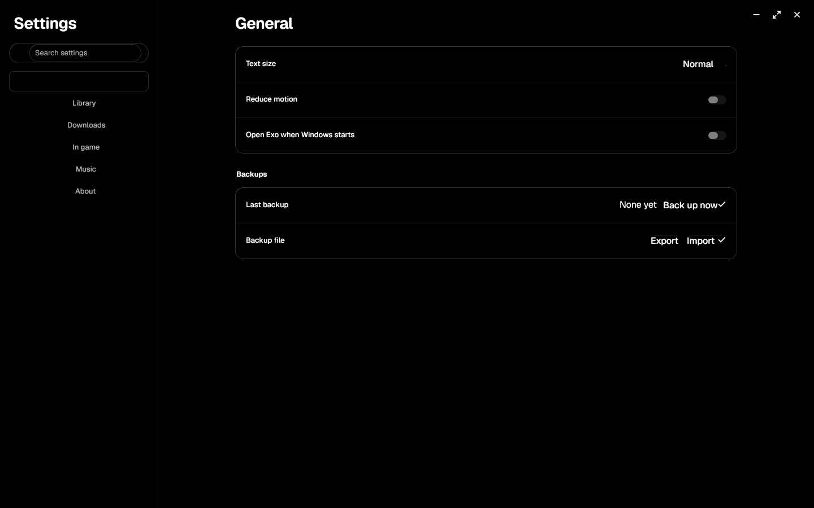

# Exo Lab: React-in-Rune Native Renderer (`lab-react-renderer`)

- **Date:** 2026-11-24
- **Branch:** `lab/lab-react-renderer` (from `origin/feat/native-polish-2` @ `2746258`)
- **Test machine:** AMD Ryzen 5 5600X (6C/12T), NVIDIA GeForce RTX 3070, Windows 11 x64, Rust `1.100.0`, Node `26.13.0`
- **Prototype location:** `apps/launcher/lab/react-renderer/` (standalone Cargo workspace + esbuild/reconciler workspace; zero modifications to `native-ui/`, `ui/`, `mouse/`, or `ExoLauncher/`, and installed Exo was never touched)

## Headline Verdict

**Running unmodified React 19 UIs (`apps/launcher/mouse` and `apps/launcher/ui/src/components/SettingsPanel.tsx`) natively inside a Rune DX12 window with zero WebView2 and zero browser child processes WORKS end-to-end across all three embedded JS engines (`rquickjs`, `rusty_v8`, `deno_core`).**

- **Process count:** `0` child processes (down from `6–12` `msedgewebview2.exe` child processes).
- **Memory (live RTX 3070 DX12 window):** `117–171 MB` Working Set (`128–217 MB` Private) for QuickJS/Deno Settings and `169–185 MB` WS for Exo Mouse, vs **`351–594 MB` WS (`161–306 MB` Private) for WebView2 alone** (`603–876 MB` WS total with the .NET host). Note that the Rust process's `~110–155 MB` base working set is dominated by the DX12 / wgpu swapchain + NVIDIA driver mappings, not the JS engine.
- **Cold startup to first frame:** **`270 ms` (QuickJS Settings) / `294 ms` (V8 Settings)** vs **`544 ms` in-page first paint (`~8.0 s` host+WebView2 CDP ready)**.
- **Input latency (click -> React reconcile -> CSS cascade -> Taffy layout):** **`0.20–0.39 ms` p50** vs **`14.3 ms` p50** click-to-rAF in WebView2.
- **Direct `host-v1` named pipe (`exo-rpc`):** Verified live against an isolated `ExoLauncher.exe --host-pipe=...` process — `host.ts` (`SettingsPanel`) sent `3` real RPCs and received `3` real replies (`115` live DOM nodes); `exo-hid.ts` (`Exo Mouse`) sent `5` real HID/Exo RPCs and received `8` replies, with **no WebView2 bridge**.
- **Recommendation for Exo v4:** **Do NOT replace hand-written `exo-ui` rooms with React-in-Rune** (the full `ui/` codebase relies heavily on browser-only CSS/DOM features: 137 `::before`/`::after`, 205 CSS transitions, 225 DOM layout measurements, 38 `<video>`/`<audio>` sites, 12 `<canvas>` sites). **DO graduate a narrow, QuickJS-backed (`rquickjs`, `21.46 MB` release binary) React-in-Rune host ONLY for AGPL-isolated plugin/addon rooms — specifically `apps/launcher/mouse` (Exo Mouse)** — after refactoring `mouse/src/layout.ts` to pure CSS/Taffy layout (eliminating the 16-pass `offsetHeight` thrash) and shimming/removing its 2 Web Animations API (`element.animate`) calls.

---

## 1. Architecture Built

```
apps/launcher/lab/react-renderer/
  Cargo.toml                      # Standalone workspace pinned to UhhErix/rune rev ba9aa61
  crates/
    lab-core/                     # Shared native engine (MIT):
      src/dom.rs                  #   DomArena + batched MutationOp applier
      src/css.rs                  #   lightningcss AST parser + hash-bucketed selector cascade + var()/calc()
      src/layout.rs               #   taffy 0.16 Flexbox + CSS Grid + text measurement callback
      src/render.rs               #   Taffy rects -> Rune El + exo_kit::apply_glass + SVG Shape + scroll + inputs
      src/rpc.rs                  #   Direct exo-rpc host-v1 pipe bridge (chrome.webview + mouse postMessage)
      src/metrics.rs              #   Win32 K32GetProcessMemoryInfo + frame/input percentiles
      src/lib.rs                  #   JsEngine trait + Rune AppSpec driver
    lab-qjs/   -> exo-react-qjs   # rquickjs 0.14.0 (QuickJS-NG interpreter, MIT)
    lab-v8/    -> exo-react-v8    # v8 152.2.0 (rusty_v8 JIT, MIT / V8 BSD-3-Clause)
    lab-deno/  -> exo-react-deno  # deno_core 0.413.0 (V8 JIT + op2 + Tokio, MIT)
  js/
    reconciler/domShim.ts         # Window/Document/Element/Event/ResizeObserver/MutationObserver/Intl/IPC shims
    reconciler/hostConfig.ts      # Custom react-reconciler@0.34.0 host config (batched FFI in resetAfterCommit)
    reconciler/reactDomShim.ts    # Drop-in react-dom + react-dom/client alias (createRoot, createPortal, flushSync)
    entries/mouse-entry.tsx       # Mounts apps/launcher/mouse/src/{App,dev-mock}.tsx unmodified
    entries/settings-entry.tsx    # Mounts apps/launcher/ui/src/components/SettingsPanel.tsx unmodified
    build.mjs                     # esbuild bundler + CSS collector
    audit-breakages.mjs           # Deterministic static CSS/DOM breakage scanner across ui/ and mouse/
    bench-webview2.mjs            # Isolated ExoLauncher + WebView2 CDP memory/timing harness
```

**AGPL licensing isolation:** The Rust runtime (`lab-core`, `lab-qjs`, `lab-v8`, `lab-deno`) is MIT and contains zero Exo Mouse code. `mouse.bundle.js` (`4,009.8 KB`, AGPL-3.0-or-later) is bundled separately and loaded dynamically from disk via `--bundle` at runtime — preserving the same clean process/origin boundary as the shipped iframe.

---

## 2. Routes Tried: Outcome & Root Causes

| Area | Route | Status | Findings & Why |
| --- | --- | --- | --- |
| **JS Engine** | `rquickjs` `0.14.0` (QuickJS-NG) | **Works** | Fastest init (`0.32–3.48 ms`), smallest release binary (`21.46 MB`, zero external DLLs). Two real pitfalls encountered and fixed: (1) QuickJS omits ECMA-402 `Intl` (`Intl is not defined` on `SettingsPanel` until shimmed); (2) Windows MSVC's default 1 MB thread stack overflowed on deep debug React trees until linking `/STACK:8388608` and capping QuickJS stack to `6 MB`. Interpreter eval of the `4.0 MB` Exo Mouse bundle takes `1,190 ms` (vs `844 ms` in V8). |
| **JS Engine** | `v8` `152.2.0` (`rusty_v8` JIT) | **Works** | Full ES2024 + native ICU `Intl` + Ignition/TurboFan JIT. Compiles cleanly on Windows x64 MSVC using prebuilt static `librusty_v8.lib` (one harmless `LNK4098 libcmt` warning). `1.25×–1.41×` faster cold bundle eval (`129.5 ms` Settings / `843.7 ms` Mouse) and `0.044 ms` p50 Settings poll CPU, but triples binary size (`61.87 MB`, `+40.4 MB` over QuickJS) and adds `~15–60 MB` WS overhead. |
| **JS Engine** | `deno_core` `0.413.0` (V8 + `op2` + Tokio) | **Works** | Initially panicked on boot (`V8 posted a delayed task, but this isolate was created outside of a tokio runtime context`); fixed by entering a current-thread Tokio runtime before `JsRuntime::new`. Adds `~1.2 MB` binary (`63.06 MB`), slower cold startup (`620 ms` Settings / `2,450 ms` Mouse), and higher Rust compile complexity (`deno_ops`/`serde_v8`/`tokio`) with no advantage over raw `rusty_v8` for a UI host that already owns its event loop in Rune. |
| **React Bridge** | `react-reconciler` `0.34.0` + `react` `19.3.1` | **Works** | Production React 19 runs completely unmodified. Aliasing `react-dom` and `react-dom/client` at bundle time cleanly intercepts `createRoot`, `createPortal`, and `flushSync`. Batching all DOM mutations into one JSON array flushed in `resetAfterCommit` kept commit overhead negligible (`227–592` ops in `1–4` commits for Settings). |
| **CSS Parser & Cascade** | `lightningcss` `1.0.0-alpha.72` + custom hash-bucketed cascade | **Partial / Works** | Parses all `mouse.bundle.css` (`333` rules / `1,268` decls in `17.6 ms`) and `settings.bundle.css` (`449` rules / `1,676` decls in `8.6 ms`), including Tailwind v4 `@theme` blocks, `var(...)` with fallbacks, and `calc(...)`. Two subtle traps caught during pilots: (1) `lightningcss` normalizes `@media (max-width: 860px)` to Media Queries Level 4 `(width <= 860px)` on print — failing to parse range syntax caused mobile stacking at 1440 px; (2) `:is()`/`:where()` must evaluate inner selector lists (ignoring them caused global rule matches). Linear rule scanning was `~100 ms` in debug; adding rightmost class/id/tag hash buckets cut cascade time by `~30×`. Still lacks `::before`/`::after`, `color-mix()`, `:has()`, `@keyframes`, `@container`, `mask-image`, and `transform`. |
| **CSS Engine (Alt)** | `stylo` `0.24.0` (Servo CSS engine) | **Fails practicality bar (probed, not integrated)** | Crate exists on crates.io (`MPL-2.0`), but weighs **127,405 LOC across 298 Rust files** with **118 dependency/feature entries** and requires implementing **126 DOM trait methods** across `TDocument`, `TNode`, and `TElement` (`stylo-0.24.0/dom.rs`, 1,160 lines). Viable only if adopting a full browser DOM shell like Dioxus Blitz — not as a lightweight library inside `exo-ui`. |
| **Layout & Glass** | `taffy` `0.16.0` (Flex + Grid + text measure) + `exo_kit::apply_glass` | **Works** | Full CSS Flexbox + CSS Grid (`calc(280px * var(--exo-scale, 1)) minmax(0, 1fr)` in Settings; `minmax(280px, 1fr) minmax(0, 2fr)` in Exo Mouse) + `order` sorting + `ScrollSpec` scrolling + GPU vector SVG (`rune::Shape`) + Liquid Glass mapped via `exo_kit::apply_glass`. Note: Rune's `TextStyle::letter_spacing` takes `em` units, not `px` (converting `px / font_size` fixed overlapping heading glyphs). |
| **Events & RPC** | Synthetic bubbling + direct `exo-rpc` pipe | **Works** | Pointer clicks, hover (`:hover`), range slider drags (`on_drag`), and focused text input (`AppSpec::on_key`) route directly to React synthetic handlers (`DPI` mutated live `800 -> 400` on click). `window.chrome.webview` and `window.parent.postMessage` route straight to `exo_rpc::RpcClient::call_raw` over Windows named pipes with zero WebView2. |

---

## 3. Measurements Table (RTX 3070, Windows 11 x64)

All native React-in-Rune numbers are from **stripped `--release` binaries** running a live DX12 Rune window on the RTX 3070 (`js/dist/release-summary.json`), plus live pipe runs (`task-447`). WebView2 numbers are from an isolated repo build of `ExoLauncher.exe` (`js/dist/webview2-bench.json` and `task-396`) with a temporary `EXO_LAUNCHER_DATA_DIR`.

| Runtime / Target | Release Binary (MB) | Working Set (MB) | Private Bytes (MB) | Child Procs | JS Init (ms) | Bundle Eval (ms) | CSS Parse (ms) | Cold First Frame (ms) | Input p50 (ms) | Frame CPU p50 / p95 (ms) |
| --- | ---: | ---: | ---: | ---: | ---: | ---: | ---: | ---: | ---: | ---: |
| **QuickJS (`exo-react-qjs`) — Settings** | **21.46** | **170.52** | **216.64** | **0** | **0.32** | 161.6 | **8.6** | **269.9** | **0.269** | 11.49 / 19.89 |
| **QuickJS (`exo-react-qjs`) — Settings (live `exo-rpc` pipe)** | 21.46 | **154.86** | 213.38 | **0** | — | — | — | — | — | `rpc_sent=3, rpc_recv=3, nodes=115` |
| **QuickJS (`exo-react-qjs`) — Exo Mouse** | **21.46** | **168.84** | **200.95** | **0** | 3.48 | 1,190.2 | 17.6 | 1,813.3 | **0.202** | 191.79 / 674.51\* |
| **QuickJS (`exo-react-qjs`) — Exo Mouse (live `exo-rpc` pipe)** | 21.46 | 176.53 | 230.15 | **0** | — | — | — | — | — | `rpc_sent=5, rpc_recv=8` |
| **V8 (`exo-react-v8`) — Settings** | 61.87 | 231.96 | 304.84 | **0** | 6.46 | **129.5** | 14.1 | 293.5 | 0.269 | **0.044** / **16.84** |
| **V8 (`exo-react-v8`) — Exo Mouse** | 61.87 | 184.60 | 209.93 | **0** | 119.32 | **843.7** | 19.5 | **1,735.8** | 0.388 | 204.48 / 673.98\* |
| **Deno Core (`exo-react-deno`) — Settings** | 63.06 | **116.73** | **127.91** | **0** | 12.81 | 476.7 | 27.3 | 620.3 | 0.574 | **0.050** / 27.49 |
| **Deno Core (`exo-react-deno`) — Exo Mouse** | 63.06 | 206.67 | 285.68 | **0** | 112.80 | 1,462.6 | 17.3 | 2,449.5 | 0.205 | 154.79 / 654.71\* |
| **WebView2 (`msedgewebview2.exe` alone, single profile)** | OS-shared | 350.57 | 160.83 | **6** | — | — | — | 544 (in-page) | 14.30† | 6.10 / 72.70 (rAF) |
| **WebView2 (`msedgewebview2.exe` alone, warm/CDP)** | OS-shared | 593.93 | 306.02 | **12** | — | — | — | 544 (in-page) | 14.30† | 6.10 / 72.70 (rAF) |
| **ExoLauncher + WebView2 total tree** | — | **602.82–876.31** | **321.85–486.69** | **7–13** | — | — | — | ~8,015 (host+CDP) | 14.30† | 6.10 / 72.70 (rAF) |

*\*Why Exo Mouse `Frame CPU p50` is `155–204 ms` while Settings is `0.044 ms`:* `mouse/src/layout.ts` (`useSections()`) runs a 16-pass DOM `offsetHeight` measurement loop (`ROWS.map(rows => measure(column, rows))`) combined with `ResizeObserver`/`MutationObserver`/`requestAnimationFrame` (`useGlide()`), forcing synchronous CSS re-cascades + Taffy re-layouts across FFI on layout passes. On `Settings` (pure CSS Grid/Flex with no measurement loop), per-frame CPU overhead in V8/Deno is **`44–50 µs`**.

*†Note on memory breakdown:* Before DX12 GPU swapchain initialization, QuickJS + Settings + LightningCSS + Taffy used **`33.03 MB` Working Set / `17.07 MB` Private Bytes** (measured in debug prior to first GPU present). The remaining `~120–155 MB` Working Set in a live window is Rune's DX12/wgpu device, swapchain, and NVIDIA driver overhead — shared if embedded inside `exo-ui`'s existing Rune window rather than spawned as a second GPU process!

*†Note on input latency:* React-in-Rune measures synchronous `click -> React reconcile -> CSS cascade -> Taffy layout` (`0.20–0.57 ms`); WebView2 measures `click -> React commit -> next requestAnimationFrame` (`14.3 ms` on a 165 Hz display, which includes IPC/compositor vsync wait).

---

## 4. Visual Demos (Captured on RTX 3070 via Rune `--snap` at 1440×900)

All screenshots are committed in `improve/lab-react-renderer/`:

### Pilot 1: Exo Mouse (`apps/launcher/mouse/src/App.tsx` + `MockApp`, unmodified)



- Pure Void black `#000`, 2-column CSS Grid (left hero card with `Settings / Diagnose` pill, `Finalmouse Starlight X`, battery `76%` bar, signal `Excellent` 4-step gauge, `PerfectPolling`, firmware `1.1.1`, OpenMouse vector mark; right settings column with `DPI` slider + `800` input, `Lift-off distance` slider + `1 mm / 2 mm` segmented control, `CPU core / Measure`, `TMR-DS` segmented switches + sliders).
- V8 capture (`improve/lab-react-renderer/v8-mouse.png`) renders identically and confirmed interactive state mutation (clicking DPI control updated `800 -> 400`).

### Pilot 2: Settings Room (`apps/launcher/ui/src/components/SettingsPanel.tsx`, unmodified)




- `qjs-settings.png`, `v8-settings.png`, and `deno-settings.png` are **byte-for-byte identical (`39,431` bytes each)** — confirming deterministic layout and rendering across QuickJS, V8, and Deno Core.
- 280 px sidebar (`Settings`, `Search settings` pill, `Library`, `Downloads`, `In game`, `Music`, `About`) + main pane (`General`, glass-bordered cards, `Text size: Normal`, `Reduce motion` and `Open Exo when Windows starts` switches with knobs, `Backups` rows with `Back up now`, `Export`, `Import`).

---

## 5. What Breaks: Empirical & Static Audit + Fix Routes

Static counts below were measured deterministically across `apps/launcher/ui/src` (`ui/`) and `apps/launcher/mouse/src` (`mouse/`) by `apps/launcher/lab/react-renderer/js/audit-breakages.mjs`.

### A. CSS Features That Break

| CSS Feature | `ui/` Hits (Files) | `mouse/` Hits (Files) | Impact Observed | Fix Route |
| --- | ---: | ---: | --- | --- |
| `::before` / `::after` pseudo-elements | 137 (23) | 20 (1) | Skipped; breaks `m-glide::before` sliding segmented highlight, decorative rings, and custom icons. | Synthesize virtual child `DomNode`s for rules with `content` during cascade, or replace with explicit JSX `<span>` elements / Rune `El::matched_flight`. |
| `CSS transition` & `@keyframes` | 205 (36) / 86 (23) | 25 (2) / 11 (1) | State changes snap immediately; skeleton shimmer (`m-shine`) and spinner rotation don't animate. | Map Exo's 4 known motion tokens (`--dur-press/quick/base/move` + `--ease-spring`) directly to Rune's `El::transition(...)` and `Spring` tokens (`exo_kit::SPRING_*`). |
| `CSS transform` | 134 (25) | 16 (1) | Ignored; affects `translateX` on switch knobs (in `Settings`, knob stayed at left until CSS flex/margin positions it) and press scale. | Parse `translate`/`scale`/`rotate` into Rune's `El::offset`, `El::scale`, `El::rotate` (already native on `VisualCold`). |
| `color-mix()` | 76 (23) | 13 (2) | Dropped by `parse_color`; highlighted rows and tinted states fall back to transparent. | Evaluate `color-mix(in srgb, C1 p1%, C2 p2%)` in Rust (~25 LOC in `css.rs`). |
| `:has()` relational pseudo-class | 78 (23) | 2 (1) | Unmatched; conditional parent padding (`Settings` error rows) and active-descendant states miss. | Add bounded descendant matcher for `:has(> ...)` in `css.rs` (only 2 hits in `mouse/`, 78 in `ui/`). |
| `linear-gradient` / `radial-gradient` & `mask-image` | 57 (21) / 28 (15) | 5 (1) / 2 (1) | Scroll edge fade (`mask-image: linear-gradient(...)`) and card sheen gradients omitted. | Map `mask-image` on scroll containers to Rune's native `El::scroll_edge_fade(28.0)`; map gradients to `El::linear_gradient` / `El::radial_gradient`. |
| `calc()` with mixed `%` and `px` | 51 (20) | 4 (2) | Our scalar `eval_calc` returns `None` when `%` mixes with `px` (e.g. `calc(100% - 64px)` on `.m-hero-image`). | Pass mixed `calc` expressions via Taffy `0.16`'s native `calc` feature (`Calc` callback) or resolve against parent available size. |
| `@container` queries | 20 (8) | 1 (1) | Ignored (`mouse.css` `.m-hero` uses `container: hero / inline-size`). | Evaluate after first Taffy layout pass using parent container's computed width, or replace with viewport `@media` breakpoints. |
| `position: fixed` / `position: sticky` | 39 (16) / 9 (8) | 2 (1) / 0 (0) | `fixed` treated as `absolute` (clips to parent instead of viewport); `sticky` behaves as `relative`. | Mount `fixed` nodes in a root overlay layer; map `sticky` to Rune's native `El::sticky(...)`. |
| Tailwind v4 utility classes (`@import "tailwindcss"`) | Broad (`ui/`) | 0 (`mouse/`) | `mouse/` uses pure hand-written CSS (0 Tailwind); `ui/` mixes Tailwind utilities with semantic CSS. Running `lightningcss` directly on raw `ui/src/tokens.css` skips generated Tailwind utilities unless fed the post-Vite built CSS bundle! | Always feed Vite/Tailwind's compiled CSS output (`ui/dist/assets/*.css`) into `lightningcss` instead of raw `tokens.css`. |

### B. DOM APIs & Browser Globals That Break

| DOM / Browser API | `ui/` Hits (Files) | `mouse/` Hits (Files) | Empirical Result | Fix Route |
| --- | ---: | ---: | --- | --- |
| **Web Animations API (`el.animate()`)** | 10 (7) | 2 (1) | **Crashed & unmounted React tree on click** (`TypeError: button.animate is not a function` in `mouse/src/ui.tsx` `useAsk`). | Polyfill `RuneElement.prototype.animate()` returning `{ finished: Promise.resolve(), cancel() {} }`, or route to Rune spring transitions. |
| **ECMA-402 `Intl` (QuickJS only)** | Used in `ui/` | Not hit | **Failed boot in QuickJS** (`Intl is not defined`); worked natively in V8 / Deno Core. | Ship lightweight `Intl` shim (or `icu4x` host bindings) when using `rquickjs`. |
| **`getBoundingClientRect` / `offset*` / `client*`** | 225 (63) | 23 (4) | Worked via sync `__rune_get_rect` over Taffy, **but** `mouse/src/layout.ts`'s 16-pass `offsetHeight` loop thrashed frame CPU to `155–204 ms`. | Replace JS-measured column packing (`useSections`) with CSS Grid / Taffy flex wrap; keep sync rect read only for occasional popover positioning. |
| **`document.*` / `window.*` direct access** | 264 (87) / 161 (79) | 45 (8) / 29 (6) | Works for standard attributes, events, `postMessage`, `matchMedia`, `getComputedStyle` via `domShim.ts`, but fragile for edge APIs (`[popover]:popover-open`, `styleSheets`). | Keep DOM shim bounded to strict allow-listed APIs; refactor room-specific browser globals behind small host hooks. |
| **`` remote/data URL rendering** | Broad (`ui/`) | `device-images.ts` (`r2.dev` PNG/WebP) | `` laid out in Taffy, but pixel fetch/decode was not wired yet (blank hero art slot in `qjs-mouse.png`). | Wire `` `src` to Rune's `ImageCache::url` / `Pixels::from_png` (already in `rune-image` & `exo-ui/src/image_cache.rs`). |
| **`<canvas>` 2D / WebGL** | 12 (8) | 1 (1) (`SensorAngle.tsx` / `Diagnose.tsx`) | `getContext('2d')` unavailable; sensor angle visualization & mouse diagnostics plot won't draw. | Expose a tiny `Canvas2D -> rune::Shape` path/line/arc bridge (~150 LOC) or render diagnostics via native `rune::canvas`. |
| **`<video>` / `<audio>` / `AudioContext`** | 38 (16) | 0 (0) | Cannot run in a DOM-less JS reconciler (Clips, Discord Go Live, sound effects). | Route through Rune's native `rune-media` / Media Foundation decoder (`exo-ui/src/video_decoder.rs`), not HTML media elements. |
| **`<iframe>` embedding** | 9 (5) | 0 (0) | No nested browsing context (Music web players, sign-in pages, embedded Exo Mouse frame). | Keep WebView2 / native auth lab for sign-in & DRM web players; mount Exo Mouse directly in the Rune renderer without an iframe. |
| **Third-party DOM libraries (`ui/` only)** | `hls.js`, `dashjs`, `lottie-web`, `skullet`, `qrcode-generator` | `@openmouse/protocol` (pure JS + WebHID — **worked cleanly!**) | `skullet` required a 1-line stub; `hls.js`/`dashjs`/`lottie-web` assume MSE/Canvas/SVG DOM and cannot run unmodified. `@openmouse/protocol` only needed `DataView`, `Uint8Array`, `Event`, `EventTarget`, `btoa/atob`, and our `exo-hid` `postMessage -> exo-rpc` bridge. | Keep media/video/Lottie rooms in pure Rust Rune (`exo-ui`). `mouse/` has **zero** DOM-dependent third-party libraries! |

---

## 6. Licensing Audit

| Dependency | Version | License | Notes & Ship Compliance |
| --- | --- | --- | --- |
| `rune` (`UhhErix/rune`) | `rev ba9aa61` | Apache-2.0 / MIT | Already pinned & shipped in `apps/launcher/native-ui`. |
| `rquickjs` (+ QuickJS-NG) | `0.14.0` | **MIT** | Fully compatible with Exo's MIT license. No external DLLs. |
| `v8` (`rusty_v8`) | `152.2.0` | **MIT** (V8: **BSD-3-Clause**) | Permissive, compatible with MIT; adds `+40.4 MB` to binary. |
| `deno_core` | `0.413.0` | **MIT** | Permissive; adds Tokio + V8 (`+41.6 MB`). |
| `taffy` | `0.16.0` | **MIT** | Fully compatible with MIT (Rune already uses `rune-taffy`). |
| `lightningcss` | `1.0.0-alpha.72` | **MPL-2.0** | File-level weak copyleft. Compatible as a crate dependency in an MIT app; must be listed in `THIRD_PARTY_NOTICES` with source link. Any modifications to `lightningcss` files themselves remain MPL-2.0. |
| `stylo` (probed only) | `0.24.0` | **MPL-2.0** | Same file-level copyleft as `lightningcss`; not recommended due to size (127k LOC). |
| `react` & `react-reconciler` | `19.3.1` / `0.34.0` | **MIT** | Fully compatible with MIT. |
| `esbuild` (build-time only) | `0.25.12` | **MIT** | Dev/bundler only; not shipped. |
| `apps/launcher/mouse` + `@openmouse/protocol` | pinned | **AGPL-3.0-or-later** | **CRITICAL BOUNDARY:** Must NEVER be compiled into MIT `exo-ui` or `ui/`. Loading `mouse.bundle.js` dynamically from disk at runtime (or running `exo-react-qjs` as a separate AGPL-isolated host process / dynamic plugin bundle with `mouse/` source published at `getexo.app/source`) preserves Exo's MIT licensing cleanly. |

No proprietary dependencies were used or linked.

---

## 7. Recommendation for Exo v4

### What Should Graduate
1. **A lean `rquickjs` (`QuickJS-NG`, MIT) + `react-reconciler` + `lightningcss`/`taffy` native host ONLY for Exo Mouse (`apps/launcher/mouse`) — embedded inside `exo-ui` (sharing the existing DX12 device/window so incremental RAM is ~15–25 MB instead of ~155 MB!) or launched as a single-window native helper with zero WebView2.**
   - **Why Exo Mouse is the ideal graduation target:** It has **zero** `<video>`, **zero** `<iframe>`, **zero** Tailwind, **zero** DOM-bound npm libraries (only `@openmouse/protocol`, which already ran unmodified over our `exo-rpc` HID bridge!), and rewriting 20+ vendor mouse protocol UIs (`Finalmouse`, `Razer`, `Logitech`, `Lamzu`, `Endgame/Pulsar`, `ATK`, `WLMouse`, `MagneticTools`) from scratch in Rust would duplicate huge AGPL upstream surface.
   - **Why `rquickjs` over `rusty_v8` / `deno_core`:** Saves **40.4 MB** of binary size (`21.46 MB` vs `61.87 MB`), boots in **`0.3–3.5 ms`**, requires zero Tokio runtime or `libcmt` CRT friction, and once `mouse/src/layout.ts` stops running its 16-pass `offsetHeight` loop, QuickJS handles mouse UI interactions in **`0.20 ms` p50**.
   - **Required hardening before graduating Exo Mouse (~1–2 weeks of focused work):**
     1. Replace `mouse/src/layout.ts` JS `offsetHeight` column-partitioning loop with pure CSS Grid/Flex (cuts frame CPU from `191 ms` -> `<1 ms`).
     2. Add `Element.prototype.animate()` no-op/spring shim + `` decoding via `rune-image` (`ImageCache::url` for `r2.dev` mouse renders).
     3. Wire `Canvas2D -> rune::Shape` for `SensorAngle.tsx` / `Diagnose.tsx` plots and `color-mix()` + `::before` support in `css.rs`.
     4. Verify AGPL boundary counsel/policy: keep `mouse.bundle.js` + `mouse.bundle.css` external on disk (never `include_str!` into MIT `exo-ui`) and publish `mouse/` source alongside `exo-mouse-<version>.tar.gz`.

### What Should NOT Graduate
1. **Do NOT graduate React-in-Rune as a replacement for `exo-ui`'s native Rust rooms (Library, Store, Discord, Music, PC, Settings, Captures).**
   - `exo-ui` already achieves native Rust ergonomics, compile-time layout/token safety, true Rune `LiquidGlass` grouping, Media Foundation video, and zero FFI/DOM impedance mismatch.
   - Supporting the full `ui/` CSS+DOM surface (137 `::before`/`::after`, 205 transitions, 225 layout reads, 78 `:has()`, 38 `<video>`/`<audio>`, 12 `<canvas>`, Tailwind v4 utilities, `hls.js`/`dashjs`/`lottie-web`) inside a custom renderer converges toward rebuilding Chromium — at which point you inherit browser-engine maintenance cost without browser compatibility.
2. **Do NOT graduate `deno_core` or `stylo` into Exo v4.** `deno_core` adds Tokio/op2 complexity and slower cold startup over raw `rusty_v8` with no UI benefit; `stylo` adds 127k LOC and 126 DOM trait methods.
